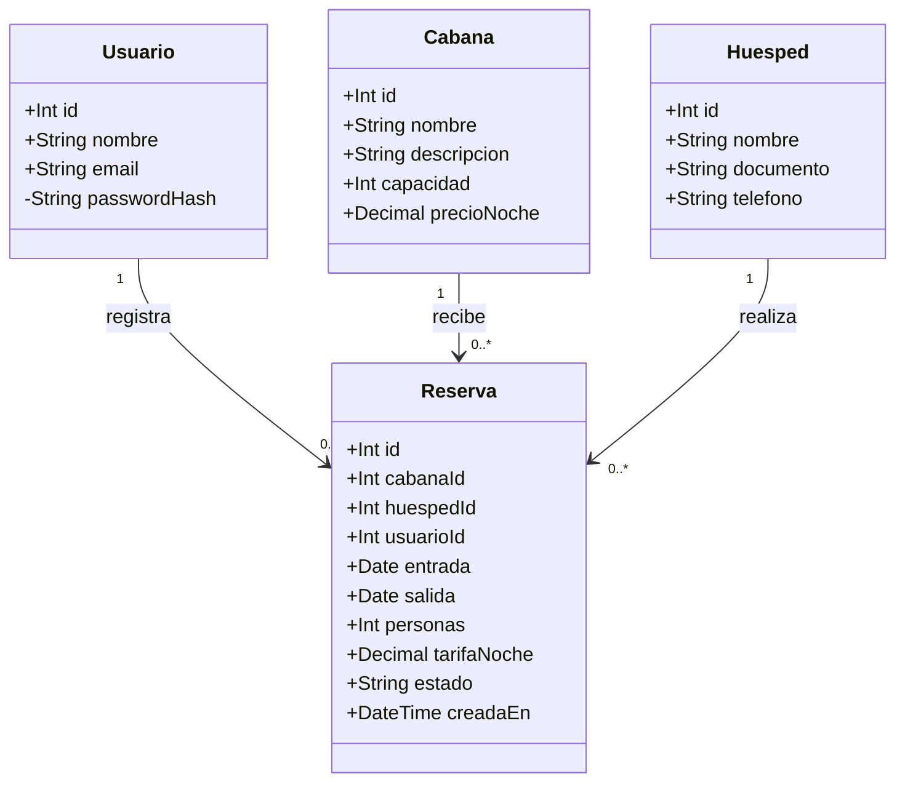

# Diagrama de clases

Cada reserva tiene exactamente un usuario responsable, una cabaña y un huésped. El modelo se implementa en `backend/prisma/schema.prisma`. Las operaciones se implementan en las rutas y servicios de la API. `passwordHash` es interno al backend.
